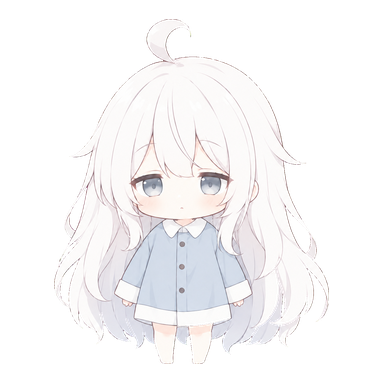

# Aikimi Forge Neo

English · [日本語](README.md)

**[v5.0.2](https://github.com/AiWithYou/aikimi-forge-neo/releases/tag/v5.0.2)** · [Changelog (Japanese)](CHANGELOG.md)



**A Windows-focused Forge Neo fork for image generation and editing, video with audio, music composition, and image or text evaluation in one WebUI.** It also provides model setup, high-resolution workflows, and image finishing tools.

Choose the model at the top of each Studio. FLUX 3 selects the official distilled or Base variant and precision. In Studios that support additional checkpoints, place them in `models/<family>/checkpoints/` or its subfolders, then refresh the list. Iris can select compatible full fine-tunes in ordinary, INT8, and W4A8 formats. See [model and LoRA layout and compatibility by family (Japanese)](docs/local-models.md).

## What's new in v5.0.2

- **[MOSS controls](docs/moss-image.md)**: hide Hires.fix in img2img and mark the negative prompt and layer skip as unused at CFG 1. Existing values are retained.
- **Reconnect during generation**: reloading the page in the same browser restores progress and cancellation controls. Jobs cannot be resumed after a server restart.
- **LoRA and reference fixes**: clear deleted edit-LoRA selections on refresh, explain the minimum reference-image size, and remove a duplicate file check immediately before applying LoRAs.

Restart the WebUI after updating. This update does not require downloading models again. [All changes (Japanese)](CHANGELOG.md#v502--2026-10-22)

### Changes in v5.0.1

- **[MOSS high-resolution generation](docs/moss-image.md#高解像度の構図調整)**: changed SDPA and INT8 activation computation. Regular S5 generation with a 2560px long edge has been checked. Completion of 4K and Hires.fix generation has not been verified with these changes.
- **Cancellation handling**: waiting for a high-resolution step to acknowledge cancellation no longer triggers a timeout-based termination of the active worker.
- **[Stops after GPU faults](docs/troubleshooting.md#gpu異常後の停止)**: GPU faults and unfinished operations block new generation and automatic GPU operations. The stop persists across restarts and provides status and explicit recovery commands.
- **Dependency security updates**: updated Pillow image processing and the certifi certificate bundle to fixed versions.

Rerun setup for the models you use, then restart the WebUI. Existing identical model files are reused. See [all changes](CHANGELOG.md#v501--2026-10-21).

[MOSS RoPE composition controls](docs/moss-image.md#高解像度の構図調整) and [H3 LightVAE](docs/minimax-h3-acceleration.md#lightvae) remain available.

### Existing v4.10 features

- **MOSS Image reliability**: restore the Hires controls after restarting, validate API denoising strength before generation, and remove PNGs from cancelled or failed jobs. See [v4.10.1 changes](CHANGELOG.md#v4101--2026-10-19).
- **[MOSS Image Hires.fix](docs/moss-image.md#拡大して仕上げるhiresfix)**: generate the composition first, enlarge the image, then run a second pass to refine details. Adjust scale, refinement steps, and denoising strength; preview final dimensions and save settings for both passes.
- **[MOSS reference images](docs/moss-image.md#参照画像から編集)**: redraw an input image or use up to three references with an editing LoRA.
- **[Merged checkpoints](docs/moss-image.md#マージモデル) and fewer steps**: select BF16 or INT8 ConvRot diffusion checkpoints and convert compatible BF16 checkpoints to INT8. An optional Euler-compatible distilled LoRA uses the regular LoRA controls.
- **Layout and generation fixes**: keep number fields and sliders inside image workspaces, preserve per-image batch metadata, and improve video saving, postprocessing, image resizing, and transparency. See the [complete changelog](CHANGELOG.md#v4100--2026-10-19).

[Setup](#setup) · [Features](#features) · [Local LoRAs](#using-local-loras) · [Updating](#updating) · [Troubleshooting](#troubleshooting)

## Setup

### Requirements

Prepare the following first. Run the commands below in PowerShell 7 (`pwsh`).

- Windows 11 (primary supported platform)
- An NVIDIA GPU and a driver compatible with CUDA 13.0
- Git, Python 3.13, PowerShell 7, and [uv](https://docs.astral.sh/uv/getting-started/installation/)

GPU memory and disk space for model downloads and conversion depend on the model. **YuE2 Music also requires Python 3.12.**

### First-time installation

```powershell
git clone --branch neo https://github.com/AiWithYou/aikimi-forge-neo.git
cd aikimi-forge-neo
```

Choose a model and run its setup BAT file. **You only need to install the models you plan to use.** Model weights are not included in this repository.

### Choose and install models

For Krea2, Anima, SenseNova, H3, Nanosaur2, or Ming, run the following and choose a menu entry (1–6). Use the dedicated BAT files in the table for Qwen, YuE2, Irodori TTS, Clef, Iris, FLUX 3, and MOSS Image.

```powershell
.\aikimi-setup.bat
```

| Model | Capabilities and interface | Setup |
|---|---|---|
| [Krea2](docs/krea2_local_supersample_detail_ja.md) | Image generation and 4K/8K workflows; open **Krea2** in the top navigation | `.\aikimi-setup.bat` → **1** |
| [Anima 3.8B v1.1](extensions-builtin/anima-3-8b/README.md) | Image generation; open **Anima** in the top navigation | `.\aikimi-setup.bat` → **2** |
| [SenseNova U1.5](extensions-builtin/sensenova-u15-studio/README.md) | Image generation and reference-based editing in its Studio | `.\aikimi-setup.bat` → **3** |
| [MiniMax H3](extensions-builtin/minimax-h3-studio/README.md) | Videos with audio and silent 360° orbits from one photo in **H3 Studio**; see the [Orbit guide](docs/minimax-h3-orbit-lora.md) | `.\aikimi-setup.bat` → **4** |
| [Nanosaur2](extensions-builtin/nanosaur2-studio/README.md) | Illustration-oriented image generation in its dedicated tab | `.\aikimi-setup.bat` → **5** |
| [Ming Image Design](extensions-builtin/ming-image-studio/README.md) | Posters, UI concepts, and transparent assets in its Studio | `.\aikimi-setup.bat` → **6** (choose INT8 or W4A8) |
| [Qwen Image 2.1](extensions-builtin/qwen-image21-studio/README.md) | Image generation, editing, transparent PNG, and outpainting | [`aikimi-qwen-image21-setup.bat`](aikimi-qwen-image21-setup.bat) |
| [YuE2 Music](extensions-builtin/yue2-studio/README.md) | Music composition and ABC score editing in **YuE2 Music** | [`aikimi-yue2-setup.bat`](aikimi-yue2-setup.bat) → **1: Official Python** |
| [Irodori TTS](docs/irodori-tts.md) | Japanese speech, caption-based voice design, and reference voice conditioning in **Irodori TTS** | [`aikimi-irodori-setup.bat`](aikimi-irodori-setup.bat) |
| [Clef / Clef-Flash](extensions-builtin/clef-studio/README.md) | Image, text, and JSON evaluation; image curation and per-criterion probabilities | [`aikimi-clef-setup.bat`](aikimi-clef-setup.bat) |
| [Iris-3B](extensions-builtin/iris-studio/README.md) | Image generation, img2img, relative depth, restoration, and 4× upscaling; standard, INT8, and W4A8 modes, compatible full fine-tunes and LoRAs, and 4-step Turbo | [`aikimi-iris-setup.bat`](aikimi-iris-setup.bat) |
| [FLUX 3 Image Klein](docs/flux3-klein.md) | Distilled/Base generation, editing with up to 10 references, bounding boxes, and separately installed optional prompt upsampling in **FLUX 3** | [`aikimi-flux3-klein-setup.bat`](aikimi-flux3-klein-setup.bat) |
| [MOSS-Image-SFT](docs/moss-image.md) | Natural-language, tag and JSON-layout generation, Hires.fix, image-to-image redraw, and up to 3 references with an edit-trained LoRA in **MOSS Image** | [`aikimi-moss-image-setup.bat`](aikimi-moss-image-setup.bat) |

The initial download and runtime setup or conversion can take time. Qwen defaults to the standard Q4_K_M model. Iris downloads weights for the selected task; INT8 and W4A8 use preconverted Hugging Face distributions. W4A8 also compresses the text encoder for image generation. See the [Iris guide](docs/iris-studio.md).

Anima is converted to INT8 on the GPU. After successful validation, the BF16 source is removed. To keep it, run `.\aikimi-setup.bat -Model anima38 -KeepSource`.

To add models or resume interrupted setup, close the WebUI and rerun the corresponding BAT file. Iris also supports setup and resuming through its **Prepare models** control. Existing files are validated and reused. For compatible models you already have, see [Local models](docs/local-models.md). Qwen and Ming can install only the runtime and shared components without downloading the standard transformer.

<details>
<summary>Individual downloads, command-line setup, and additional options</summary>

To select a model directly:

```powershell
.\aikimi-setup.bat -Model anima38
```

Add `-DryRun -NoPause` to preview the planned actions without making changes.

If the runtime is already installed, these BAT files download model weights separately:

- Krea2: [download_krea2_int8_convrot_models.bat](download_krea2_int8_convrot_models.bat)
- Anima: [download_anima38_v11_int8_convrot_models.bat](download_anima38_v11_int8_convrot_models.bat) (requires a GPU)
- SenseNova: [download_sensenova_u15_models.bat](download_sensenova_u15_models.bat)
- MiniMax H3: [download_minimax_h3_models.bat](download_minimax_h3_models.bat) / [additional W4A8 models](download_minimax_h3_w4a8_models.bat)

Anima's individual download and conversion require a prepared Neo runtime and an NVIDIA GPU. The individual SenseNova and H3 BAT files do not install their dedicated runtimes.

Install the official full Qwen models (INT8 / W4A8 / BF16) with `.\aikimi-qwen-image21-setup.bat --official-full`. Install optional prompt rewriting with `.\aikimi-qwen-image21-setup.bat --prompt-rewriter-only`. See the [Qwen guide](extensions-builtin/qwen-image21-studio/README.md), [quantization guide](docs/w4a8.md), and [model installation guide](docs/model-installation.md).

Install [Official Qwen Image 2.1 Turbo](docs/qwen21-official-turbo.md) with `.\aikimi-qwen-image21-setup.bat --official-turbo-only`, then choose **Official Turbo · W4A8 / INT8 / BF16** in Qwen. Official Turbo recommends 8 steps; Viggle Turbo recommends 4. Steps remain editable. ControlNet combinations and strengths outside the recommended range are allowed; recommendations appear as nonblocking notices.

Preconverted Official Turbo [INT8](https://huggingface.co/Aikimi/Forge-Neo-Image-2.1-Turbo-INT8) and [W4A8](https://huggingface.co/Aikimi/Forge-Neo-Image-2.1-Turbo-W4A8) distributions are available on Hugging Face. See the [Official Turbo guide](docs/qwen21-official-turbo.md) for shared components, runtime requirements, and commands.

</details>

### Launch and generate

1. After setup, double-click `aikimi-launch.bat`. Use this file for everyday launches too.
2. When the log displays the URL, open [http://127.0.0.1:7861](http://127.0.0.1:7861) in a browser.
3. Open the desired interface, set generation parameters, and generate. The model links above lead to instructions and examples.

The default `LocalSafe` profile is accessible only from your PC. It does not automatically publish the WebUI to your LAN or the internet. The first launch also prepares the core libraries.

<details>
<summary>Low VRAM, API, and LAN launch profiles</summary>

Select a profile from PowerShell:

```powershell
.\aikimi-launch.ps1 -Profile LowVRAM
```

| Profile | Purpose |
|---|---|
| `LocalSafe` | Normal use: WebUI and API on your PC only |
| `LocalAPI` | API only, on your PC |
| `LowVRAM` | Lower GPU memory environments |
| `RTX3090Recommended` | RTX 3090 |
| `Development` | Development and UI checks |
| `LANAuthenticated` | Authenticated access from other devices on your LAN |

For LAN access, create Git-ignored `secrets/gradio-auth.txt` and `secrets/api-auth.txt`, with one `username:password` pair per line. Internet access also requires TLS and firewall configuration. See [Connection and authentication](docs/security-model.md).

For personal settings when using `webui-user.bat`, create and edit this file:

```powershell
Copy-Item .\webui-user.example.bat .\webui-user.local.bat
```

</details>

## Features

### Image editing, expansion, and finishing

| Goal | Feature and guide |
|---|---|
| Expand an image | [Qwen Outpaint](extensions-builtin/qwen-image21-studio/README.md#outpaint補助): drag edges or corners to define the canvas; boundary width 0 preserves every original pixel |
| Edit masks and control images | [Qwen Image 2.1](extensions-builtin/qwen-image21-studio/README.md): boxed annotations, masks, and Fun ControlNet |
| Redraw at 4K / 8K | [Krea2 high-resolution workflows](docs/krea2_local_supersample_detail_ja.md) and [HyperWeave](extensions-builtin/hyperweave/README.md); inferred details can change, and some features are experimental |
| Reduce grain | Extras → [Grain Cleaner](docs/grain-cleaner.md): CPU processing without an additional model |
| Make transparent PNGs | Extras → [Background removal](docs/background-removal.md): single images or batches |
| Adjust brightness or color variation | Color Flatten and color variation inspection in Extras, or [CD Tuner](docs/cd-tuner-negpip.md) during generation |

### Everyday controls

- Choose an image model from the top navigation and use the shared `txt2img` / `img2img` layout. Buttons at the top show LoRA, ControlNet, and other model options. Reference-based editors use their own editing controls; Ming and Nanosaur2 offer text generation only. See the [shared image workspace guide (Japanese)](docs/image-workspace.md).
- Iris img2img supports compatible full fine-tunes and strength from 0 to 1 with standard sampling. Strength 0 preserves the resized input; strength 1 matches txt2img with the same settings and seed. Turbo LoRAs must be removed for img2img. See the [Iris guide (Japanese)](docs/iris-studio.md#入力画像から描き直すimg2img).
- Under **GPU / model retention**, choose the option that prioritizes consecutive generation to keep models loaded between jobs. Manual release is also available. See [Model retention](docs/model-retention.md).
- Click **Chibi Aikimi** to view progress and the queue. Drag it to move it, and use the top menu to toggle its visibility.

### Using local LoRAs

Place compatible LoRAs in the directories below, or enter a full path in the selector and press Enter.

| Interface | Directory inside the project | How to apply |
|---|---|---|
| Forge `txt2img` / `img2img` | `models/Lora/` | Select in the LoRA combination control, or use `<lora:name:0.8>` |
| Qwen Image 2.1 | `models/Qwen-Image-2.1/loras/` | **LoRA → Refresh → select multiple** |
| Ming Image | `models/Ming-Image/loras/` | Select under **Model / LoRA** |
| Iris (image generation) | `models/Iris-3B/loras/` | **LoRA → Refresh → select multiple**. See [supported formats and Turbo (Japanese)](docs/iris-studio.md#任意のloraとコミュニティ製turbo) |

Strength ranges from −2 to 2. A value of 0 disables the LoRA; × removes the selection. Do not specify the same LoRA in both the selector and prompt. Different model generations or formats may be incompatible. See [Supported formats and external paths](docs/local-models.md) and the [Qwen LoRA guide](extensions-builtin/qwen-image21-studio/README.md#追加lora).

For Qwen style, color, or lighting edits that preserve composition, prepare [Consistency LoRA](docs/qwen21-consistency-lora.md) from the LoRA panel. It downloads the standard 1500 variant and preserves existing selections and strengths. It may limit changes to pose.

Select a compatible local Qwen Image 2.1 GGUF or INT8 ConvRot transformer under **Checkpoint**. See [Local models](docs/local-models.md) for model folders, formats, and shared components.

<details>
<summary>Tag completion, acceleration, and advanced settings</summary>

For Danbooru-style tag suggestions, install [Tag Autocomplete](https://github.com/DominikDoom/a1111-sd-webui-tagcomplete) and restart Neo. Tab accepts the first suggestion; Enter accepts a suggestion selected with the arrow keys.

```powershell
git clone https://github.com/DominikDoom/a1111-sd-webui-tagcomplete.git extensions/tag-autocomplete
```

- **Compute adjustments**: [Jev / Sparse Attention](docs/jev-sparse.md) and [Krea2 examples](docs/krea2-jev.md). Jev automatic decisions use your API key, with limits on calls and waiting time. Fixed ratios do not call an API.
- **Qwen extensions**: [Qwen Fun Acc (4-step)](docs/assets/qwen-image21-fun-acc/README.md) and [Fun ControlNet](docs/assets/qwen-image21-fun-controlnet/README.md).
- **MiniMax H3 details**: [Long-form generation](extensions-builtin/minimax-h3-studio/README.md#長尺生成), [acceleration](docs/minimax-h3-acceleration.md), [CLIP cache](docs/minimax-h3-clipcache.md), and [ControlNet](docs/minimax-h3-fun-control.md).
- **Quantization comparisons**: [INT8 / W4A8](docs/w4a8.md).
- **H3 Image (still images)**: [H3 Image guide](extensions-builtin/minimax-h3-studio/IMAGE_GUIDE.md). Experimental; real-model GPU image generation, quality, and speed have not been validated.

</details>

## Updating

Close the WebUI, open PowerShell in the project directory, and run:

```powershell
git switch neo
git pull --ff-only origin neo
```

If your checkout uses an older repository URL, first run `git remote set-url origin https://github.com/AiWithYou/aikimi-forge-neo.git` once.

**For SenseNova or Qwen runtimes installed before September 24, 2026**, update the corresponding runtime before launching. Model weights do not need to be downloaded again.

```powershell
# Existing SenseNova installation
.\download_sensenova_u15_int8.ps1 -RuntimeOnly

# Existing Qwen Image 2.1 installation
.\aikimi-qwen-image21-setup.bat --runtime-only
```

After any required updates, launch `aikimi-launch.bat`. Core dependencies are prepared during startup. Custom `TORCH_COMMAND` or `TORCH_INDEX_URL` settings take priority. See the [changelog](CHANGELOG.md) for version-specific notes.

If you installed Clef in a development build before v3.6.0, close the WebUI and run `.\aikimi-clef-setup.bat --runtime-only` to update its dedicated runtime. Existing quantized weights can be reused.

If you installed MOSS Image in v4.9.0, run setup once with your current precision settings to refresh file verification. For the default INT8 configuration, run `.\aikimi-moss-image-setup.bat`. Matching downloaded weights are verified and reused. See [precision options](docs/moss-image.md#導入) for BF16 or W4A8 installations.

## Troubleshooting

For startup failures, model-loading errors, or insufficient GPU memory, see [Troubleshooting](docs/troubleshooting.md). **Diagnostics** in Settings reports your environment status.

For standard txt2img / img2img, turn off **Settings → Optimizations → Batch Cond/Uncond** to process positive and negative conditioning separately while preserving the image batch size. The default is ON.

Before sharing logs or generation parameters, check for passwords, personal directory paths, and prompts you do not want to publish.

<details>
<summary>Differences from Forge Neo and development documentation</summary>

This project is based on [Stable Diffusion WebUI Forge - Neo](https://github.com/Haoming02/sd-webui-forge-classic/tree/neo), with additional model Studios, setup tools, finishing features, and UI navigation.

Basic Krea2 and Anima support and quantized model loading are inherited from Forge. The default branch is `neo`; the synchronization baseline is `0d0cb72951b059c8ea17861ba86db8d0f6098c28`. Later selected changes are listed in [Upstream updates](docs/upstream-sync.md).

- [Development environment and tests](CONTRIBUTING.md)
- [Architecture](docs/architecture.md)
- [API and security model](docs/security-model.md)
- [Reporting security issues](SECURITY.md)
- [Release checklist](docs/release-checklist.md)

Most detailed guides are currently in Japanese.

</details>

## License and usage terms

Code is licensed under [AGPL-3.0](LICENSE). Check each publisher's terms for models, VAEs, text encoders, LoRAs, and assets. Models and ComfyUI are the work of their respective developers. Sources and individual terms are listed in the feature guides and [Third-party notices](THIRD_PARTY_NOTICES.md).
