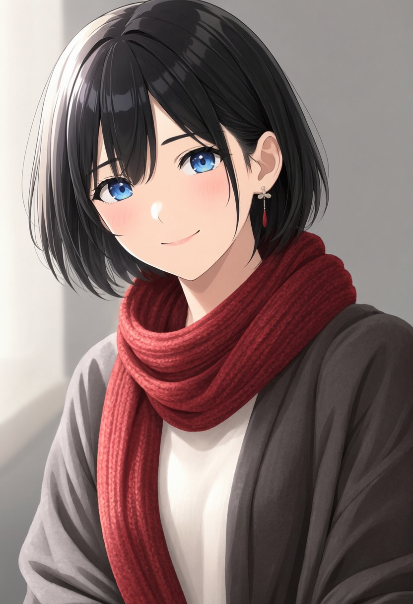

# MOSS-Image-SFT

[MOSS-Image-SFT](https://huggingface.co/OpenMOSS-Team/MOSS-Image-SFT) は、OpenMOSSの5B画像生成モデルです。自然文、タグ列、JSONレイアウトから画像を生成できます。Forge Neoでは **MOSS Image** Studioを使用します。

## 導入

```powershell
.\aikimi-moss-image-setup.bat
```

既定ではSFTの画像生成本体とテキストエンコーダーをINT8 ConvRotで取得します。VAEは公式のFP32を保持します。モデルは`models/MOSS-Image/`、MOSSに標準対応した専用の固定ComfyUIは`repositories/moss-image/`へ導入します。NVIDIA CUDA GPUと、セットアップ済みのForge Neo環境が必要です。

画像生成本体はINT8／BF16、テキストエンコーダーはINT8／W4A8／BF16を個別に選択できます。量子化版はコミュニティ配布で、BF16版とは細部が変わる可能性があります。選んだ形式が未導入の場合、自動で別の形式へ切り替えません。

標準のINT8構成は約14.1GBです。テキストをW4A8にする場合は次のように導入し、Studioでも同じ形式を選択します。この構成の重みは約11.1GBです。これらはファイル容量で、生成中のVRAM使用量とは異なります。

```powershell
.\aikimi-moss-image-setup.bat --text-precision w4a8
# BF16本体とINT8テキストを導入する場合
.\aikimi-moss-image-setup.bat --precision bf16 --text-precision int8
```

INT8本体・エンコーダーは[Abiray版](https://huggingface.co/Abiray/MOSS-Image-SFT-INT8-convrot)、W4A8エンコーダーは[nif0版](https://huggingface.co/nif0/MOSS-Image-SFT-ComfyUI)を固定リビジョンとSHA-256で検証します。

## 生成

1. **MOSS Image** を開き、プロンプトを入力します。英語の自然文またはタグ列を利用できます。
2. 解像度、ステップ数、CFG、Seedを設定し、生成します。標準値は1024×1024、50ステップ、CFG 3、Shift 5、負条件側の22層スキップです。
3. 生成画像と条件を保存したPNGをダウンロードできます。中断ボタンで処理を停止できます。

このStudioでは幅と高さを512〜4096の16の倍数で指定します。合計は16,777,216画素までです。4Kサイズも入力できますが、実際に生成できるサイズはGPUの空きメモリーとモデルの処理量で変わります。負のプロンプトと負条件側の層スキップを変更できます。Seedを固定すると同じ条件で再生成できます。プロンプトは自動書き換えしません。公式のチャット形式を含めて4096トークンを超える入力は、途中で切り捨てずエラーにします。

JSONレイアウトもプロンプト欄にそのまま入力できます。公式形式は `summary.caption`、`items`、`bbox_format: "yxyx"`、`bbox_coord_space: "abs_centralized"` です。座標は画像の中心を原点とするピクセル値で、生成時の解像度に合わせます。

## 拡大して仕上げる（Hires.fix）

**txt2img**で「拡大して仕上げる（Hires.fix）」をONにすると、幅・高さで指定したサイズで構図を生成し、画像をLanczosで拡大してから、同じモデル・LoRA・プロンプトで細部を再生成します。倍率、仕上げSteps、仕上げの変更量を設定できます。最終サイズは設定欄に表示します。

標準は倍率1.5、仕上げ20ステップ、変更量0.35です。変更量はGUI・APIとも0.01〜1です。小さくすると構図を保ちやすく、大きくすると描き直す範囲が増えます。仕上げStepsは2段階目で実際に実行するステップ数です。CFG・Shift・層スキップ・Seedは両段階で共通です。同じSeedでも、サイズが異なるため各段階のノイズ配列は異なります。

倍率は1.05〜4、最終寸法は16ピクセル単位で最も近い値へ丸めます。最終サイズも1辺4096ピクセル・合計16,777,216画素までです。上限を超える設定は生成前にエラーになります。JSONレイアウトの座標は最初に生成する幅・高さに合わせてください。img2imgではこの設定を使用しません。

既定値として保存したHires.fixのON/OFFと仕上げ設定は、再起動後の設定欄と最終サイズにも反映されます。初期読み込み中に値を変更した場合も、読み込みと変更の処理後は最後の入力に表示を揃えます。寸法の入力途中でもHires.fixのON/OFFは切り替えられます。生成時の寸法検査は引き続き行います。

拡大後の再生成とVAEの追加処理に時間とメモリーが必要です。画像の内容によって細部や構図が変わるため、結果を確認してください。完了したPNGと生成条件JSONに、最初と最後の寸法、両段階の設定・実行ステップ数・拡大方法を保存します。中断・失敗したジョブのPNGと一時画像は、処理の停止を確認してから削除します。

APIでは`width`・`height`を**最終サイズ**にし、任意の`hires`オブジェクトに最初のサイズと仕上げ条件を指定します。`hires`を省略すると通常生成になります。`hires`はtxt2imgでのみ使用できます。

```json
{
  "prompt": "An anime portrait, delicate line art, soft daylight",
  "width": 1536,
  "height": 1536,
  "steps": 50,
  "seed": 7,
  "hires": {"base_width": 1024, "base_height": 1024, "steps": 20, "denoise": 0.35}
}
```

## 参照画像から編集

共通ワークスペースの **img2img** を選び、参照画像と変更したい内容を入力します。txt2imgへ戻ると、画面に保持された参照画像は生成に使用しません。

- **元画像から再描画**: 画像を1枚入力し、完成画像の内容をプロンプトで説明します。「変更量」が小さいほど元画像を保持し、大きいほど描き直します。大きな色変更を試す設定例は変更量0.8・Steps 50・CFG 5です。サイズは幅・高さで指定し、「画像のサイズを使う」で元画像の比率に合わせられます。
- **編集LoRAで複数参照**: 最大3枚を入力し、MOSSの編集学習用LoRAを選択します。指示では `Picture 1`、`Picture 2` のように参照を区別できます。参照キャッシュはLoRAの学習設定に合わせます。標準はONです。通常の画風LoRAだけでは指示編集の品質は保証されません。

再描画は元画像のVAE潜在とテキスト指示を使います。編集用LoRAによる複数参照は[Ostrisの編集方式](https://github.com/ostris/ComfyUI-MOSS-Image-Ostris-Edit)に対応し、Qwen3.5の画像理解入力と、各参照を独立した位置・時刻0で扱うVAE潜在を使用します。複数参照の潜在は1枚約1メガピクセル以内、画像理解用入力は384×384相当以内に縮小します。元のアップロード画像は変更しません。画像は1枚40メガピクセルまでです。

公式SFTは画像生成モデルです。再描画と編集学習用LoRAによる参照編集では、保持できる内容や指示への追従が異なります。編集用LoRAは別途用意してください。参照画像の順序・SHA-256・実際に使ったサイズを生成条件へ記録します。

APIの `POST /sdapi/v1/moss-image/jobs` でも、`mode: "img2img"`、base64画像の配列 `images`、`edit_method: "redraw"` または `"reference"` を指定できます。再描画の `denoise` は0.01〜1です。複数参照では編集用LoRAを `loras` に指定し、学習設定に応じて `kv_cache` を選びます。画像のURLやローカルパスは受け付けません。

## 蒸留版の少ステップ生成

```powershell
.\aikimi-moss-image-setup.bat --with-dmd
```

上の任意コマンドで[lodestonesの現行Euler対応LoRA](https://huggingface.co/lodestones/MOSS-Image-SFT-8-steps-dmd)を約1.19GB追加できます。通常の **LoRA** 欄で `presets/lora_latest.safetensors` を選び、強度 **0.7**、**Steps 8・CFG 1** に設定します。4ステップにも変更できます。専用のモード切替や自動設定変更はありません。通常の画風LoRAも重ねられます。取得時は固定リビジョンとSHA-256で検証します。

CFG 1では負のプロンプトと負条件の層スキップを使いません。通常生成へ戻す場合は蒸留LoRAを外し、StepsとCFGを戻します。編集用LoRAとの組み合わせの品質は未確認です。旧data-space版や他の4ステップ用アダプターとは生成方式が異なり、それらをこの設定へ置き換えることはできません。

## 作例



832×1216、50 steps、CFG 3、Shift 5、負条件の22層スキップON、Seed 2026101701、負のプロンプト空欄、LoRAなし。本体・テキストはINT8 ConvRot、VAEはFP32です。元のPNGにも生成条件を保存しています。

```text
A single young woman with short black hair and a red scarf, half-body portrait, looking at the viewer with a gentle smile, soft daylight, refined Japanese anime illustration, clean line art, detailed blue eyes, warm gray background.
```

RTX 3090（24GB）、RAM 64GB、Windows 11、ドライバー610.74、専用PyTorch 2.13.0+cu130で確認しました。この作例の生成処理は約81秒、観測したGPU全体のVRAMピークは12,171MiBでした。初回のファイル整合性確認は別途時間がかかります。解像度・文章の長さ・LoRA・ほかのアプリによって必要量は変わります。実GPUで確認した保存形式はINT8本体＋INT8テキストです。

## 高解像度の構図調整

設定欄の「高解像度の構図調整（RoPE）」で横・縦のスケールを0.25〜4の範囲で調整できます。どちらも**1が標準**です。高解像度で被写体が増える、構図が崩れる場合は、1より小さい値から同じSeedで比較してください。値は画質を保証するものではなく、プロンプトや解像度によって結果が変わります。

通常生成・再描画・参照編集で使用できます。Hires.fixでは各段階に同じ指定を使います。横・縦を別に調整でき、画像サイズやStepsは自動変更しません。APIでは`"rope": {"scale_x": 0.75, "scale_y": 0.75}`を指定し、省略時は両方1です。PNGと生成条件JSONには実際のスケールを記録します。

専用ComfyUIとcomfy-kitchen 0.2.39を使用します。INT8 ConvRotではSiTU活性化と量子化の融合を利用します。LoRAや使用GPUによって実際の速度は変わります。更新時は使用する保存形式でセットアップを再実行してください。

## マージモデル

MOSS Image互換の画像生成本体を、単一の`.safetensors`として`models/MOSS-Image/checkpoints/`へ置きます。「モデル」の一覧を更新して選択すると、BF16またはINT8 ConvRotの保存形式が反映されます。テキストエンコーダーとVAEは導入済みの共通部品を使用します。公式モデルへ戻す場合は「MOSS-Image-SFT」を選びます。

ファイルの全対象・形状と保存形式を検証し、生成条件のPNGとJSONへモデル名とSHA-256を記録します。選択したモデルが削除・変更された場合は生成を停止します。マージ済みモデルには、同じLoRAを重ねて選択すると差分が二重に適用されます。

BF16のMOSS本体からINT8 ConvRotを作成する場合は、Forge環境で次を実行します。元のファイルは保持し、42層の252個の線形投影を量子化します。

```powershell
.\venv\Scripts\python.exe -m tools.convert_moss_int8_convrot --source models/MOSS-Image/checkpoints/MyMOSS.safetensors --output models/MOSS-Image/checkpoints/MyMOSS-int8-convrot.safetensors
```

## LoRA

MOSSの画像生成本体と互換の線形LoRAを`models/MOSS-Image/loras/`へ置き、一覧を更新して選びます。最大16件の複数選択と個別の強度調整に対応します。通常の`lora_A/lora_B`または`lora_down/lora_up`形式を読み、対象と形状が一致することを検証します。学習元の名前だけで拒否したり、モデル・Steps・CFGを自動変更したりしません。

量子化した本体にもLoRAの差分を適用します。保存した量子化モデルは書き換えず、変更したLoRAの選択・強度は次の生成に反映します。PNGと生成条件JSONに実際のLoRA名・SHA-256・強度を記録します。MOSS以外のLoRAや未対応の追加方式は、対応する対象を確認できなければエラーになります。

LoRA適用時は重みを一時的に復元して計算するため、追加のメモリーが必要です。ComfyUIのサンプリングを使用するため、同じSeedと設定でも元のDiffusers出力との画素一致は保証しません。

文字の正確さやレイアウトの再現は生成結果を確認してください。

モデルと公式推論コードはApache-2.0です。詳細は[公式ユーザーガイド](https://github.com/OpenMOSS/MOSS-Image/blob/main/USERGUIDE.md)を参照してください。
